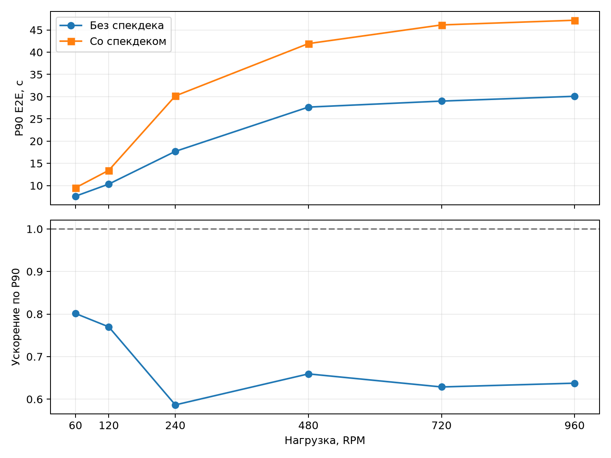
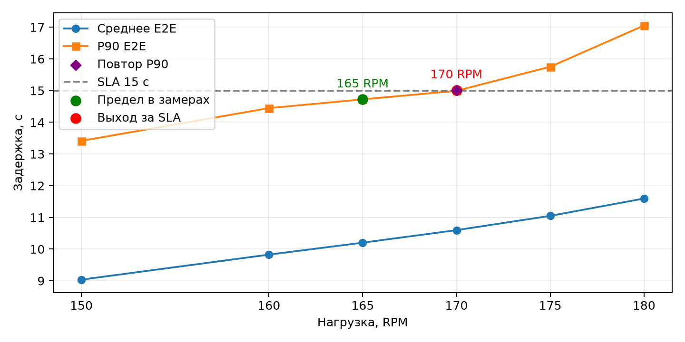

# ДЗ 6. Ускорение инференса

Запускал Qwen/Qwen3-8B на одной NVIDIA A100 с 80 ГБ памяти. Использовал vLLM 0.22.0 и AIPerf 0.13.0. Запросы взял из файла задания как есть. Режим рассуждений выключен, температура 0, сид 42, лимит 512 токенов.

Перед замером сбрасывал кэш префиксов и отправлял 40 запросов для прогрева. В таблицы они не попали. Клиент отправлял запросы через равные интервалы и засекал время до конца ответа. Параллельные замеры шли на одинаковых картах с разными ядрами CPU.

## 1. Задержка при 120 RPM

На каждой конфигурации отправлял все 640 запросов. Среднюю задержку стандартного vLLM делил на среднюю задержку тестируемого варианта. P90 показывает, за какое время успели получить 90% ответов.

| Конфигурация | Настройка | Среднее, с | P90, с | Ускорение, раз | Ошибок |
|---|---|---:|---:|---:|---:|
| base | Настройки vLLM по умолчанию | 7,744 | 11,107 | 1,000 | 0 |
| prefill2048 | Задал стандартный лимит в 2048 токенов на батч | 7,776 | 11,211 | 0,996 | 0 |
| prefill512 | Уменьшил лимит до 512 токенов | 7,821 | 11,260 | 0,990 | 0 |
| prefill16384 | Увеличил лимит до 16384 токенов | 7,677 | 10,971 | 1,009 | 0 |
| interactive | Включил interactivity | 7,182 | 9,901 | 1,078 | 0 |
| base_ngram | Добавил n-gram с 4 черновыми токенами | 9,094 | 13,697 | 0,852 | 1 |

При лимите в 512 токенов vLLM делит длинный запрос на большее число частей. Первый токен приходил в среднем за 161 мс вместо 135. Лимит в 16384 токена сократил среднюю задержку менее чем на 1%. При повторе со стандартным лимитом в 2048 токенов средняя задержка отличалась от базовой примерно на 0,4%.

Лучше всего сработал interactivity. Его и стандартный vLLM замерял на одной карте. Interactivity заранее готовит CUDA-граф для каждого размера батча до 32. При стандартной настройке часть этих размеров пропускается. Первый токен приходил почти за то же время. Между токенами задержка упала с 17,97 до 16,68 мс. На ответе длиной около 420 токенов такая разница заметна. Средняя задержка снизилась на 7,3%, P90 на 10,9%.

В прогоне с n-gram на одном запросе оборвалось соединение. Задержку посчитал по 639 ответам.

## 2. Спекулятивное декодирование при разной нагрузке

Для каждой пары замеров брал одни и те же 160 запросов в одном порядке. N-gram ищет совпадения длиной от 2 до 5 токенов и предлагает до 4 следующих. Черновик проверяет сама модель. На высоких RPM клиент быстро отправлял все 160 запросов. Для долгой нагрузки сделал отдельный тест.

| RPM | P90 без спекдека, с | P90 с n-gram, с | Ускорение по P90, раз |
|---:|---:|---:|---:|
| 60 | 7,610 | 9,497 | 0,801 |
| 120 | 10,334 | 13,423 | 0,770 |
| 240 | 17,689 | 30,161 | 0,586 |
| 480 | 27,649 | 41,933 | 0,659 |
| 720 | 29,000 | 46,132 | 0,629 |
| 960 | 30,082 | 47,187 | 0,638 |

С n-gram P90 был выше на всех шести точках замера, от 60 до 960 RPM. На 240 RPM время до первого токена изменилось всего на 19 мс, а задержка между токенами выросла с 28,95 до 46,41 мс. С учётом прогрева модель принимала от 24 до 25% предложенных токенов. В ответ попадал примерно один токен из четырёх.

При включении n-gram vLLM переключается с V2 на V1. Я отдельно запустил V1 с выключенным спекдеком. На 60, 120 и 240 RPM получил P90 7,61, 10,19 и 17,75 с. Это почти те же цифры, что у V2 без спекдека. На одном и том же V1 n-gram тоже проиграл.

## 3. Предел нагрузки

Запустил interactivity через load_test.sh. На каждой точке отправлял запросы 300 секунд, затем ждал оставшиеся ответы. Когда запросы в исходном файле заканчивались, AIPerf снова читал его с начала. Проверял, что клиент держал заданный темп, запросы прошли без ошибок, а P90 остался меньше 15 секунд.

| Цель, RPM | Отправлено запросов | Среднее, с | P90, с | SLA |
|---:|---:|---:|---:|:---|
| 150 | 749 | 9,036 | 13,414 | Да |
| 160 | 800 | 9,825 | 14,447 | Да |
| 165 | 825 | 10,203 | 14,723 | Да |
| 170 | 850 | 10,598 | 14,993 | Да |
| 170, повтор | 850 | 10,587 | 15,016 | Нет |
| 175 | 875 | 11,049 | 15,752 | Нет |
| 180 | 899 | 11,595 | 17,053 | Нет |

165 RPM оказались наибольшей нагрузкой, где все прогоны уложились в SLA. Это 2,75 запроса в секунду при P90 14,723 с. На 170 RPM первый замер прошёл с запасом в 7 мс, но повтор на той же карте вышел за предел. На 175 RPM P90 превысил порог на 0,75 с. В этой серии все запросы завершились без ошибок.

С 150 до 180 RPM среднее время до первого токена выросло со 146 до 170 мс. Длина ответа осталась примерно той же, около 420 токенов. Каждый следующий токен приходил в среднем за 26,87 мс вместо 21,04. За весь ответ набралось несколько секунд.

- [Таблица 120 RPM](summary/tuning.csv) и [замеры спекдека](summary/spec.csv)
- [Замеры на V1](summary/spec_check.csv)
- [Нагрузочные замеры](summary/load.csv)
- [Команды запуска](README.md)
